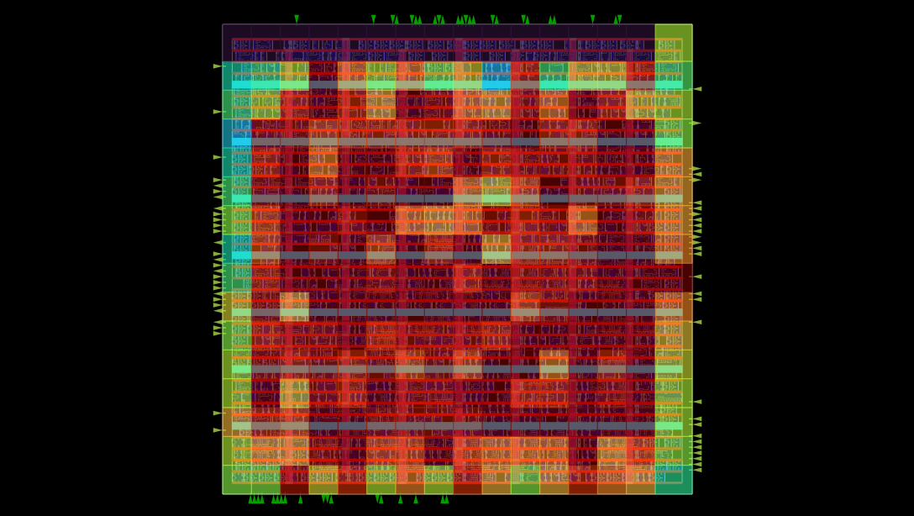
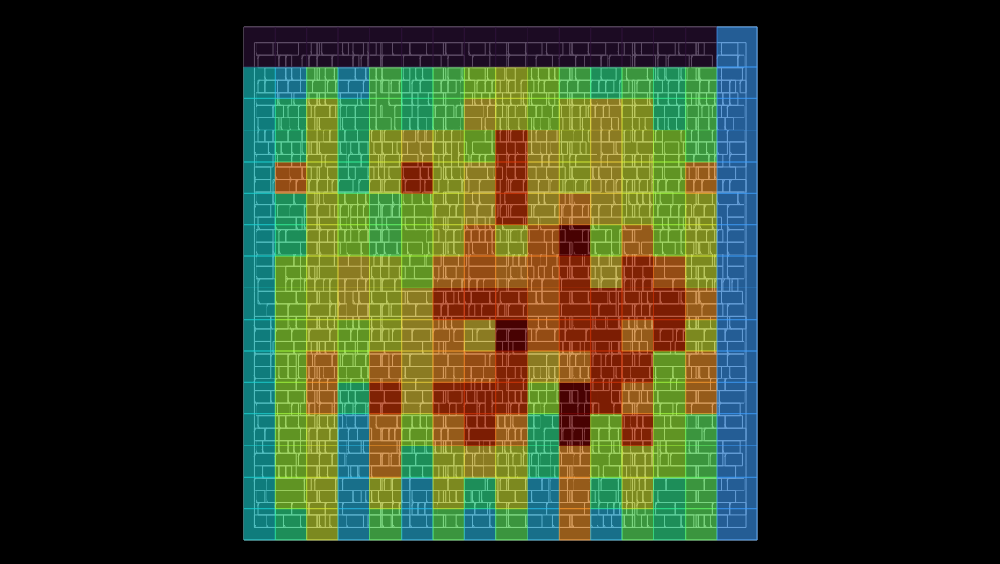
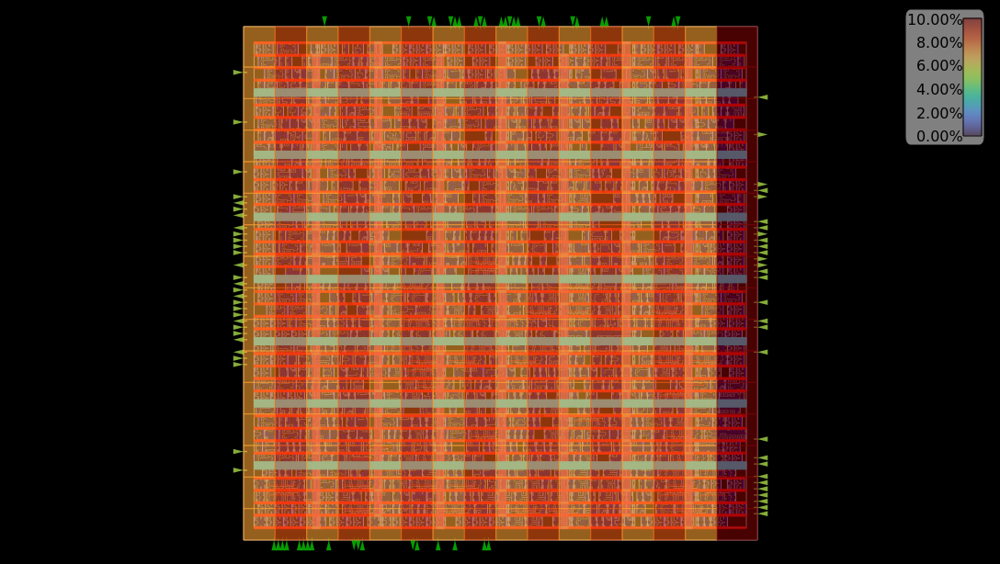
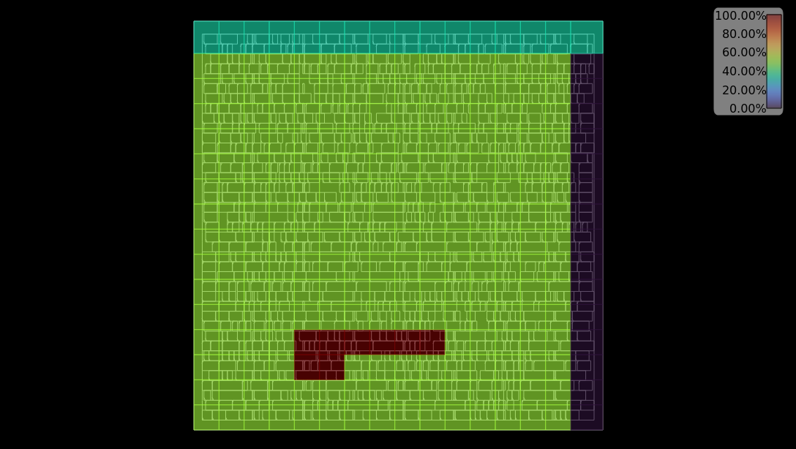
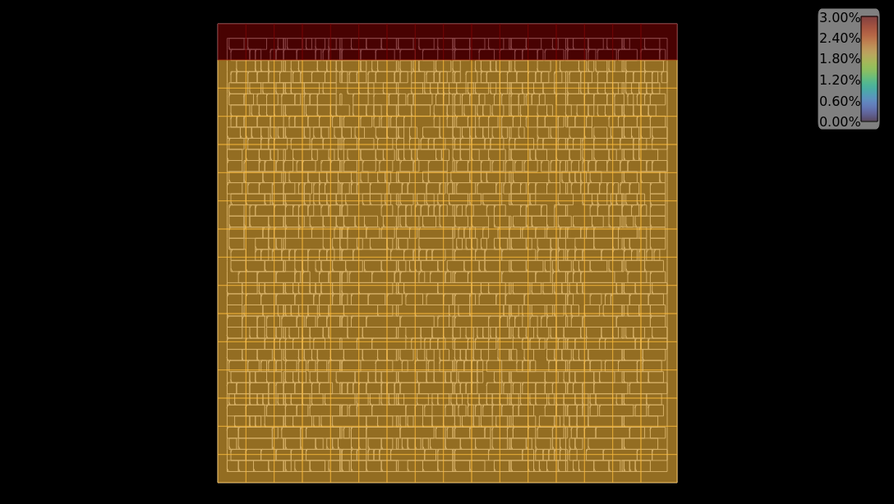
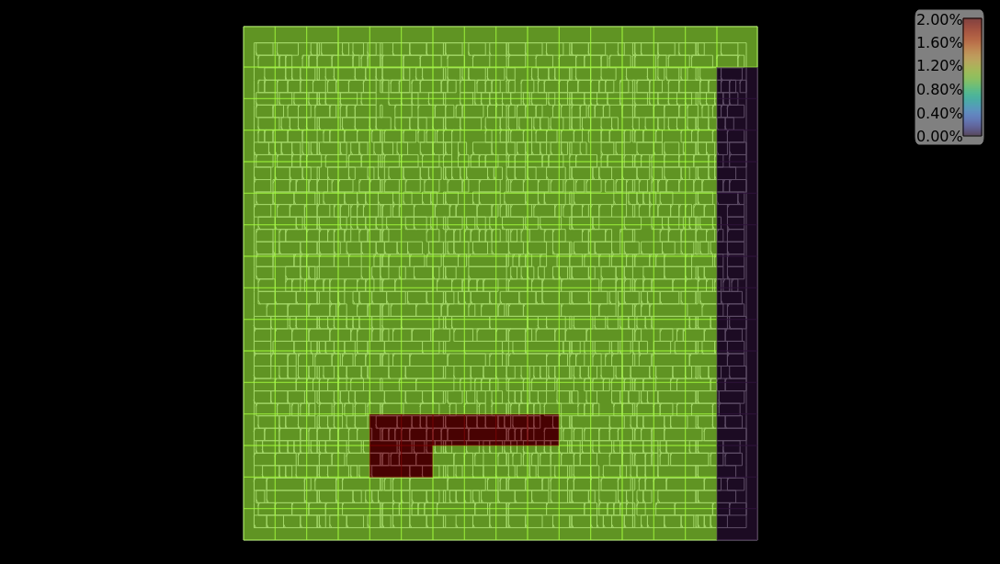

# Experiment 2: From placement to routing difficulty

Design: `alu32` (combinational ALU, no clock). Platform: `sky130hd`. Flow: OpenROAD-flow-scripts (ORFS), run to `finish`.

## Question

How does a tighter floorplan turn into routing difficulty?

The chain followed here: floorplan, global placement, global routing, detailed routing.

## What was changed

Only `CORE_UTILIZATION`. Each run has its own `FLOW_VARIANT`, so the results do not overwrite each other.

| Run | `CORE_UTILIZATION` | `FLOW_VARIANT` |
|---|---:|---|
| base | 40 | default |
| utilization_60 | 60 | `utilization_60` |
| utilization_75 | 75 | `utilization_75` |

All other settings are the same in the three runs (`designs/alu32/config.mk`). The ORFS commit and the OpenROAD version are in `data/run_info.txt`.

Command for utilization_75 (the other runs change `FLOW_VARIANT` and `CORE_UTILIZATION`; base sets neither):

    make -f /home/vu/eda/repos/OpenROAD-flow-scripts/flow/Makefile DESIGN_CONFIG=/home/vu/PD_projects/rtl2gds-alu-pd-experiments/designs/alu32/config.mk WORK_HOME=/home/vu/PD_projects/rtl2gds-alu-pd-experiments/work FLOW_VARIANT=utilization_75 CORE_UTILIZATION=75 finish

## Data

- `data/<run>/stage_evidence.txt`: lines copied from the logs and reports of the run.
- `data/utilization_75/routability_round.txt`: the only routability round of utilization_75 (global placement log).
- `data/utilization_75/def_evidence.txt`: PDN stripes and met5 wires from the final DEF.
- `data/utilization_75/gui/`: heatmap screenshots, taken from `5_1_grt.odb`.

## 1. Floorplan

The requested utilization is shown by `IFP-0107`. The instance area is 8807.197 µm² and the instance count is 1258 in all runs (`IFP-0103`, `IFP-0105`), so only the core changes. The core edges snap to the site and row grid (`IFP-0028`), so the effective utilization is a little above the request.

| | base | utilization_60 | utilization_75 |
|---|---:|---:|---:|
| Die side, µm (`IFP-0100`) | 152.385 | 125.155 | 112.365 |
| Core area, µm² (`IFP-0102`) | 21688.301 | 14423.834 | 11418.451 |
| Rows x sites (`IFP-0001`) | 54 x 321 | 44 x 262 | 39 x 234 |
| Effective utilization (`IFP-0104`) | 0.406 | 0.611 | 0.771 |
| Fixed cell area (tap cells), µm² (`GPL-0017`) | 350.336 | 230.221 | 178.922 |

## 2. Global placement

| | base | utilization_60 | utilization_75 |
|---|---:|---:|---:|
| Utilization seen by the placer (`GPL-0019`) | 49.381% | 74.237% | 93.748% |
| Warning "target density too low" (`GPL-0302`) | no | yes | yes |
| Target density used (`GPL-0023`) | 0.6000 | 0.7500 | 0.9400 |
| Routability rounds (number of `GPL-0041` messages) | 13 | 9 | 1 |
| Total cell inflation (`GPL-1012`) | +7.83% | +14.37% | +0.00% |
| Final HPWL, µm (last row of the HPWL table) | 29851 | 26297 | 23254 |
| Design area after this stage, µm² | 9856 | 9743 | 9677 |

The `global_placement` command asks for density 0.6 in all runs. In utilization_60 and utilization_75 the placer finds that 0.6 is too low for the free area (`GPL-0302`) and raises it. In both runs the new target is slightly above the utilization the placer sees.

In routability mode the placer measures congestion, inflates cells in congested tiles, and repeats. `GPL-0041` is the total routing overflow, `GPL-0042` the number of overflowed tiles and `GPL-0047` the weighted congestion. In utilization_75 only one round runs. Round 1 (see `data/utilization_75/routability_round.txt`):

1. Weighted congestion is 1.2608 (`GPL-0047`). It is the average of the top 0.5% and top 1% tile congestion: (1.2629 + 1.2587) / 2 (`GPL-0043`, `GPL-0044`).
2. The placer wants to inflate cells by 689.767 µm², +6.48% (`GPL-0086`).
3. It removes 3 filler cells (24.453 µm²). 665.314 µm² is left to compensate by raising the density (`GPL-0078`). Check: 689.767 - 24.453 = 665.314.
4. The density needed is 1.0090 (`GPL-0079`). The maximum allowed is 0.9900 (`GPL-0053`).
5. The placer reverts inflation and density to the round with the lowest congestion, which is round 1 itself (`GPL-0055`). It stops: "could not reach target" (`GPL-0089`).

So utilization_75 ends with total inflation 0.00% (`GPL-1012`). The placement is not repaired for congestion.

## 3. Placer estimate and real global route

The `global_placement` command has no `-routability_use_grt`, so the placer uses its own congestion estimate, not a global route.

| | base | utilization_60 | utilization_75 |
|---|---:|---:|---:|
| Overflowed tiles in round 1 (`GPL-0042`) | 3.72% | 12.65% | 22.27% |
| Final routing usage, all layers (`GRT-0096`) | 32.64% | 44.35% | 52.95% |
| Final routing overflow (`GRT-0096`) | 0 | 0 | 0 |

The placer estimate and the real usage rise in the same order. But the placer reports overflow in every run, and the global router finds none.

## 4. Global routing

| | base | utilization_60 | utilization_75 |
|---|---:|---:|---:|
| Total resource (`GRT-0096`) | 16089 | 10689 | 8461 |
| Total demand (`GRT-0096`) | 5252 | 4741 | 4480 |
| met1 usage | 50.04% | 62.37% | 68.68% |
| met2 usage | 48.13% | 65.89% | 74.34% |
| met5 demand | 0 | 0 | 8 |
| Extra iterations (`GRT-0101`) | 3 | 0 | 3 |

Resource follows the core area: 10689 / 16089 = 0.664 against a core area ratio of 0.665, and 8461 / 16089 = 0.526 against 0.526. Demand falls much more slowly. It follows roughly the square root of the core side: 0.903 for a side ratio of 0.816, and 0.853 for 0.726. So usage goes up.

No `congestion.rpt` was written in any run (see the `ls` of the reports directory in `stage_evidence.txt`).

Four different wirelength numbers (compare each row across runs only, not between rows):

| | base | utilization_60 | utilization_75 |
|---|---:|---:|---:|
| Final HPWL of global placement | 29851 | 26297 | 23254 |
| `globalroute__route__wirelength__estimated` (`5_1_grt.json`) | 30311.8 | 27489 | 25357.2 |
| Total wirelength of global route (`GRT-0018`) | 58615 | 54089 | 51950 |
| Final wire length of detailed route | 38634 | 35369 | 33320 |
| Detailed route / HPWL | 1.294 | 1.345 | 1.433 |

## 5. Detailed routing

All three runs end with 0 violations. The base log has a second `detailed_route` pass after the first one reaches 0; only the first pass is used here.

| | base | utilization_60 | utilization_75 |
|---|---:|---:|---:|
| Violations at iteration 1 (`DRT-0199`) | 1207 | 1371 | 1716 |
| Iterations to reach 0 (first pass) | 6 | 8 | 8 |
| Short share of the iteration 1 violations | 69.5% | 73.3% | 75.5% |
| Wire length at iteration 1, µm | 39456 | 36060 | 33883 |
| Violations per 100 µm of wire, iteration 1 | 3.06 | 3.80 | 5.06 |

Most violations are Short and Metal Spacing on met1.

## 6. Heatmaps (utilization_75, `5_1_grt.odb`)

The screenshots come from the OpenROAD GUI (`gui_grt`). The heatmap is "Routing Congestion" on a 6.9 µm grid (16 x 16 tiles). The option Type has three choices: congestion, capacity and usage. Colors were read by eye against the legend of each image, so the percentages are rough.

### met2: the most congested layer

met2 is mostly red and dark red inside the core, the most of all layers. This fits its 74.34% usage in `GRT-0096`.

### met4: the PDN stripes and the capacity

On met4 the hot tiles are in the middle of the core and a bit to the right.

The capacity of met4 alternates by tile column. The PDN stripes on met4 are at x = 15.87, 29.44, 43.01, 56.58, 70.15, 83.72 and 97.29 µm (`data/utilization_75/def_evidence.txt`). Divided by the tile size 6.9 µm, these are tile columns 2, 4, 6, 8, 10, 12 and 14 (counted from 0). These columns look lower in capacity (about 6-7% on the legend) than the odd columns (about 8-9%). The stripe width is 1.6 µm, which is 23% of a tile, the same order as the drop.

### met5: one signal wire and the PDN stripes

| Congestion | Capacity | Usage |
|---|---|---|
|  |  |  |

The three maps look consistent with congestion = usage / capacity. Most of the core is flat. The top row of tiles has a higher capacity (legend up to 3.00%), because the tile row is taller. The usage legend goes up to 2.00%.

The thin horizontal lines are the PDN stripes of met5 drawn on top of the heatmap (stripes at y = 16.32, 29.92, 43.52, 57.12, 70.72, 84.32 and 97.92 µm), not values of the heatmap.

There is one dark red block of 8 tiles: 6 tiles in one row and 2 tiles in the row below. `GRT-0096` also reports a met5 demand of 8. The final DEF has only one met5 signal wire, on net `_0444_`, from x = 33.58 µm to x = 67.62 µm at y = 25.5 µm (`def_evidence.txt`). With the 6.9 µm grid it covers tile columns 4 to 9 in tile row 3, which are the 6 tiles of the upper row of the block.

## Conclusions

- A tighter core shrinks the routing resource in proportion to the core area, but the routing demand shrinks much more slowly. Usage rises from 32.64% to 44.35% to 52.95%.
- The placer raises the target density by itself. At utilization 75 the density it needs (1.0090) is above the limit (0.9900), so the routability step is abandoned and the placement is not repaired for congestion.
- The placer congestion estimate follows the same order as the real result, but it reports overflow where the global router finds none.
- Detailed routing reaches 0 violations in all runs, but it starts with more violations as the floorplan gets tighter (1207, 1371, 1716).
- On met4, the tile columns with PDN stripes seem to have lower capacity.

## Questions

Why does global routing need 3 extra iterations (`GRT-0101`) in base and utilization_75, but none in utilization_60?

Why is the total wirelength of global route (`GRT-0018`) about 1.5 to 1.6 times the wire length of detailed route?

From 40 to 60, HPWL falls by a factor 0.881 while the core side falls by 0.816. From 60 to 75, HPWL falls by 0.884 and the core side by 0.890. Why does HPWL follow the core side only in the second step?

The new target densities (0.7500 and 0.9400) are both the placer utilization rounded up to two decimals. Is this the rule?

What do the usage and capacity values of the heatmap measure? On met5 the legend of the usage map goes up to 2.00% and the legend of the capacity map to 3.00%, but `GRT-0096` reports a total demand of only 8.

The only met5 signal wire in the final DEF lies under the 6 tiles of the upper row of the dark red block on met5. What explains the 2 tiles of the lower row?

Is `congestion.rpt` written only when there is real overflow? No run here had overflow.